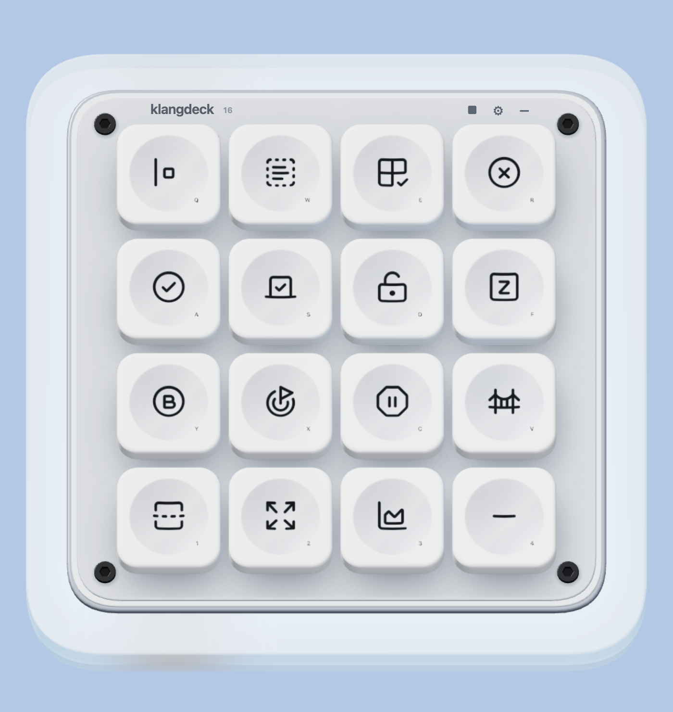

# Klangdeck

A local 3D soundboard for Apple Silicon Macs. Sixteen keys per bank, your own audio files, keyboard controls, and customizable icons.

## Use the app

1. Open `Klangdeck.app`. You can move it to Applications.
2. Drop an audio file onto a key. Empty keys open the file picker. Choose an icon afterward or keep the assigned icon.
3. Play sounds with your mouse or keyboard. New banks use Q W E R / A S D F / Y X C V / 1 2 3 4. Existing banks keep their sounds and key bindings.
4. Open Settings to choose or add a bank, import sounds, change key bindings, or pick icons. The full Lucide catalog works offline, with scrolling and search.
5. Press ⌘⇧Space to show or hide Klangdeck. Escape stops all sounds. ⌘Q quits.

Klangdeck must be running for the global shortcut to work. Sound keys work when its window has focus. If another app already uses the shortcut, open Klangdeck from the Dock.

Imported audio and settings stay in `~/Library/Application Support/Klangdeck`. The app copies imported audio into its database, so you can move the original files afterward. Klangdeck has no cloud upload. The optional Chrome extension mixes sounds locally into a Google Meet call; other video-call apps are not supported.

## Google Meet in Chrome

1. Open Settings in Klangdeck and expand Google Meet.
2. Click Prepare extension. This creates a persistent extension folder and registers only the local Chrome connection `local.klangdeck.meet`.
3. Open `chrome://extensions` in Chrome, enable Developer mode, and use Load unpacked to select the Klangdeck extension folder.
4. Reload any Meet tabs that were already open. Keep your usual microphone selected; your voice and Klangdeck sounds are mixed locally.

Klangdeck must be running to send new sounds. Your microphone continues working without it. Meet's mute control also mutes soundboard audio. Multiple simultaneous Meet calls block sound transmission. Local playback on your Mac stays active. Headphones help prevent acoustic feedback. If Meet suppresses effects, check its noise cancellation setting.

After moving or updating the app, renew the setup if needed and reload the extension in Chrome. Klangdeck does not install extensions automatically, change Chrome settings, or need a virtual audio driver. Imported clips remain in the local database; the extension receives only clips being played, never a copy of your microphone recording.

Automated checks use a local WebRTC loop and a simulated microphone. After setup, verify that another participant can hear your sounds in a real Meet call. A live Meet call has not been claimed as an automated test result.

## Shell lighting

The rounded shell has two layers of milky glass and recessed hexagonal screws. Ocean-blue light moves slowly from right to left, with a subtle reflection on the plate and white keys.

In Settings, open Shell lighting to choose a color or reset it to Ocean blue. Color fill controls how much of the shell is colored: 0% switches the colored light and reflection off; 100% fills almost the whole shell while leaving a narrow moving gap. New and existing installations without a saved fill value start at 50%.

Color, fill, and motion are saved automatically and restored at launch. Turn off Move light slowly to freeze the lighting. Reduce Motion in macOS also freezes it. Hiding Klangdeck stops rendering; 0% fill stops the continuous lighting animation while key presses still animate.

## Development

Use Node.js 24 or newer. Run `npm ci`, then `npm start`. `npm run dev` starts a browser preview; the global shortcut works only in the Mac app. `npm test` checks data migration, icon search, and native validation without changing user data.

`npm run package` creates a local arm64 app in the output folder. No Xcode project is required. The local app is not Developer ID signed or Apple notarized; public distribution is not configured.

## Design and licenses

The key shape is based on Wawa's keyboard-configurator. The source file and bundled attribution identify the original geometry and its license. Klangdeck synthesizes its demo sounds and does not include third-party audio recordings.

The pale keys display Lucide icons and a small keyboard shortcut. Sound names remain available in Settings and accessible labels. The app includes the full Lucide license and its Feather/MIT notices.
